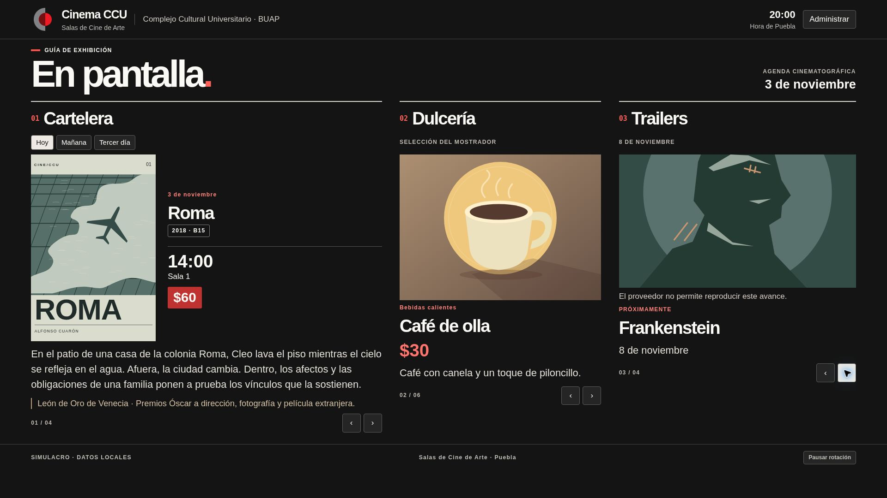

# Cinema CCU · Pantalla y Cartelera Digital

Cartelera para el vestíbulo de las Salas de Cine de Arte del Complejo Cultural Universitario BUAP. La primera apertura en modo local carga un simulacro con fechas relativas a Puebla. Las funciones, clasificaciones y precios del ejemplo sirven para pruebas. Los logotipos provienen del proyecto Cinema CCU v0.7. Los carteles y productos de muestra son ilustraciones, no materiales oficiales de las películas.

## Abrir en la computadora de cabina

1. Descomprime el proyecto. Abre una terminal en la carpeta que contiene este README.
2. En Windows con Python instalado ejecuta `py -m http.server 8000 --bind 127.0.0.1 --directory dist`. En macOS o Linux sustituye `py` por `python3`.
3. Abre http://localhost:8000 en Chrome o Edge. Usa F11 para pantalla completa y zoom de 100 % para el monitor de 1920 × 1080.
4. Pulsa F2 o **Administrar**. En el primer acceso elige nombre y PIN de administrador (6–12 dígitos). No hay credenciales predeterminadas. Usa HTTPS en una instalación remota para poder administrar.
5. Cerrar la ventana de administración termina la sesión. Conserva el PIN y un respaldo del contenido antes de borrar los datos del navegador.

## Usar la pantalla y cargar contenido

La cartelera recorre todas las funciones en orden de hora antes de pasar al siguiente día. Cada ficha de hoy dura 35 segundos y las de mañana y tercer día duran 14. Elegir un día detiene el avance de la cartelera durante 45 segundos. Los productos cambian cada 8.5 segundos. Las flechas permiten avanzar manualmente. **Pausar rotación** permite leer la pantalla detenida.

En **Cartelera** crea una ficha por película. En **¿Cuántas funciones tendrá?** elige de 1 a 5 e indica fecha, hora y sala para cada función. Al editar, puedes aumentar o reducir la cantidad y guardar todos los horarios juntos. Las funciones antiguas conservan sus datos y se pueden ampliar desde el mismo editor. Selecciona **Entrada libre** para sustituir el precio. **Editar** recupera la ficha completa, **Guardar cambios** la actualiza y **Cancelar edición** limpia el formulario. En **Dulcería** ingresa categoría, precio, descripción e imagen. Desmarca **Activo** para retirar el producto de la pantalla sin perder su ficha. En **Próximos estrenos** captura fecha, etiqueta y enlaces. Los enlaces de imagen pueden apuntar a HTTPS o a recursos del propio sitio. En Cartelera y Próximos estrenos también puedes usar **Subir póster desde mi computadora**, con JPG, PNG o WebP de hasta 10 MB. Se muestra una vista previa y la imagen se optimiza al guardar. El archivo subido tiene prioridad sobre la URL. Usa **Quitar póster actual** sin seleccionar un archivo nuevo para retirarlo. Los pósters subidos se incluyen en los respaldos y se conservan dentro de la ficha tanto en modo local como en nube. En modo local consumen el espacio del navegador; si se agota, se informa el error y se conservan los datos anteriores.

Los trailers usan reproducción silenciada para pantallas automáticas. Aceptan watch, youtu.be, shorts, live o embed, con tiempos en segundos o minutos. Al terminar un avance se pasa al siguiente. Un error o falta de respuesta presenta el póster y un mensaje. La reproducción depende del navegador, la red y los permisos del titular del video. Un límite de cuatro minutos evita que un reproductor atascado bloquee la rotación.

## Usuarios y respaldos locales

Desde el acceso inicial, **+ Gestionar usuarios** requiere autenticación de Administrador. **Cambiar mi PIN** exige la identificación del usuario y su PIN actual. El Administrador puede dar de alta, editar, cambiar rol o PIN, desactivar y eliminar cuentas. Debe quedar un Administrador activo. El alta múltiple admite una persona por línea en formato `nombre | rol | PIN`. Si una línea falla, se cancela el lote.

| Rol | Permiso |
| --- | --- |
| Administrador | Todas las secciones, usuarios, TMDB y respaldos |
| Programación | Cartelera y próximos estrenos |
| Dulcería | Productos y precios |
| Consulta | Lectura de las tres secciones de contenido |

Los datos y los hashes de PIN con sal individual y PBKDF2 viven en localStorage. El modo local sirve para una computadora de confianza. Cada navegador tiene sus propios datos. El respaldo JSON cubre el contenido; los PIN y las cuentas no se exportan. Restaurar reemplaza el catálogo local. La pantalla se actualiza entre pestañas del mismo origen.

## Configurar TMDB

En **Configuración / TMDB**, ingresa un API Read Access Token de TMDB. Se conserva en sessionStorage de esa pestaña. No lo agregues al repositorio. En **Cartelera** o **Próximos estrenos**, abre **Buscar película en TMDB** e indica título y opcionalmente año. Elige una coincidencia, revisa los campos y guarda. El importador solicita metadatos en español de México y consulta trailers en inglés cuando faltan en español. Conserva URLs de imagen en lugar de descargar archivos. El acceso directo desde navegador permite inspeccionar el token en esa pestaña. Para un servicio compartido conviene trasladar la consulta a una función de servidor.

## Conectar Supabase

1. Crea un proyecto de prueba y ejecuta **SUPABASE_SETUP.sql** una vez en un esquema nuevo desde SQL Editor. Crea movies, candy, upcoming y profiles. Cada fila de contenido guarda id UUID y payload JSONB.
2. En Authentication crea usuarios de correo y contraseña. Copia su UUID. Desde el editor de tablas agrega una fila a profiles con ese id, el rol escrito exactamente como en la tabla anterior y active=true. Crea primero el Administrador. Gestiona identidades, contraseñas administrativas y roles desde la consola de Supabase. El cambio de la contraseña propia está disponible en la aplicación.
3. En **dist/config/settings.js** cambia mode a 'cloud', url a la Project URL y key a la **publishable key** o **anon key**. Estos dos valores son públicos. Nunca incluyas service_role, secret keys, contraseña de PostgreSQL, JWT signing secret ni tokens administrativos.
4. Publica de nuevo e inicia sesión con correo y contraseña. Ingresa funciones de prueba. En una ventana privada verifica la lectura pública y que los inactivos no se muestren. Un usuario sin perfil activo carece de permisos de escritura. RLS verifica el rol en la base de datos y bloquea que el cliente cambie su propio perfil.
5. Los datos de demostración permanecen en el navegador anterior. La base en nube comienza vacía. Verifica la matriz de permisos con cuentas de prueba antes de capturar datos de operación. El cliente actualiza la pantalla cada 30 segundos. Si una sesión caduca, vuelve a identificarte.

## Publicar

**GitHub Pages.** Crea un repositorio vacío y sube este árbol a la rama main. En Settings → Pages elige GitHub Actions. Ejecuta **Cinema CCU Pages** en Actions o empuja un commit a main. El flujo ejecuta las pruebas y despliega dist. Usa la URL publicada en el resumen del despliegue. Si partes del ZIP, inicializa Git con `git init -b main`, agrega los archivos, crea el primer commit, agrega el remoto de tu repositorio y ejecuta `git push -u origin main`.

**Cloudflare Pages o Netlify.** Importa el repositorio como sitio estático, sin comando de compilación y con directorio de publicación **dist**. No requiere dependencias para servir la aplicación. Para cambiar cartelera entre dispositivos configura primero el modo nube.

## Estructura y verificación

- dist/index.html, styles, scripts, assets y config contienen la aplicación.
- SUPABASE_SETUP.sql contiene el esquema y las políticas de acceso.
- tests/display.test.mjs cubre roles, persistencia de edición, cinco usuarios, desactivación, cambio de PIN, altas múltiples, calendario y normalización de enlaces.
- Ejecuta `npm test` con Node 22 o posterior. No requiere npm install.
- preview-1920x1080.png es la captura del navegador durante el simulacro. En la prueba de título largo, el pie terminó en el píxel 1079 y el documento midió 1920 píxeles de ancho. En la prueba de avance próximo el encabezado cambió del 3 al 8 de noviembre y se mostró el respaldo ante el bloqueo de reproducción.

## Alcance de esta versión

Las pruebas automatizadas se ejecutaron en modo local. El acceso real a TMDB y la instalación de SQL/RLS en un proyecto Supabase quedan pendientes de credenciales. El simulacro se crea una sola vez; las funciones de ejemplo caducan normalmente al pasar las fechas. Para cargar la cartelera real, edita el calendario en administración. Antes de operar dos pantallas en producción, valida Supabase con dos navegadores, un usuario por rol y el monitor físico del vestíbulo.

No se adjunta una licencia abierta a los logotipos institucionales ni a materiales de terceros.
